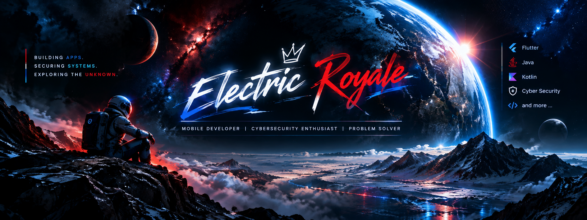

  

<h3>&lt;/&gt; Tech Stack</h3>
<table width="100%">
  <tr>
    <td nowrap><b>💻 Languages</b></td>
    <td>
      
      
      
      
      
      
      
    </td>
  </tr>
  <tr>
    <td nowrap><b>⚙️ Tools</b></td>
    <td>
      
      
      
      
    </td>
  </tr>
  <tr>
    <td nowrap><b>☁️ Services</b></td>
    <td>
      
      
      
      
      
      
      
    </td>
  </tr>
  <tr>
    <td nowrap><b>🛡️ Security</b></td>
    <td>
      
      
      
      
      
      
      
    </td>
  </tr>
  <tr>
    <td nowrap><b>🌱 Currently Learning</b></td>
    <td>
      
    </td>
  </tr>
</table>

### 👨🏼‍💻 About me

- 🛠️ I write code in my free time, mostly because I enjoy building things and seeing them work.
- 🔐 I spend a lot of my evenings on [Hack The Box](https://app.hackthebox.com/profile/019f8520-9702-70ab-808f-449a64283f58), breaking into machines and learning how systems fail.
- 🧩 Whether it's a bug, a CTF challenge or a messy workflow, I love solving problems with computers.

### 📁 Featured Projects

> #### 📱 Swimming Club Management System &nbsp; 
>
> Application written in Flutter (frontend) and Kotlin (backend) to digitalize club management. Handles registration for club events and competitions, member management, training attendance and more.
>
> [🔗 Website](https://app.sv-hockenheim.de) · [▶ Demo](mailto:demo@sv-hockenheim.de)
>
>    

> #### 🎓 Graduation Ball Ticket Management
>
> Ticket management system for my graduation ball. Students reserved tickets via Google Forms, and a Python script wrote the data into a Firebase database. After a student had paid, I sent the ticket as a PDF with a QR code from my Flutter frontend. A second app scanned and validated the tickets at the entrance.
>
> *Personal project.*
>
>    

> #### 🏠 Custom Home Assistant Dashboard
>
> A custom-built Home Assistant dashboard that uses the HA RESTful API to fetch data and control smart-home devices.
>
> *Personal project.*
>
>    

> #### 🐦 Flappy Bird – Unity 2D Game
>
> A Flappy Bird clone for desktop and Android, built with Unity and C#. Features a one-tap gameplay loop, procedurally spawned pipes, a persistent highscore, a pause function and sound effects.
>
> *Personal project.*
>
>    

### 🎯 Goals

- Keep growing my offensive security skills
- Build small tools that automate boring tasks

<table width="100%">
  <tr>
    <td width="25%" valign="top" align="center">⚡ <b>Currently working on</b> Swimming Club Management System</td>
    <td width="25%" valign="top" align="center">🌱 <b>Currently learning</b> Securing a software backend and more…</td>
    <td width="25%" valign="top" align="center">⭐ <b>Fun fact</b> I started developing on vacation, taught by a friend 😄</td>
  </tr>
</table>

  
  
  
  

<i>Thanks for visiting my profile! 👑</i> Better Apps. Safer Tomorrow.

